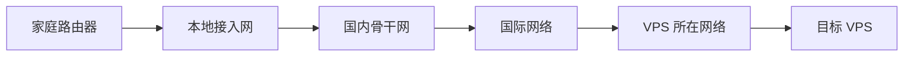
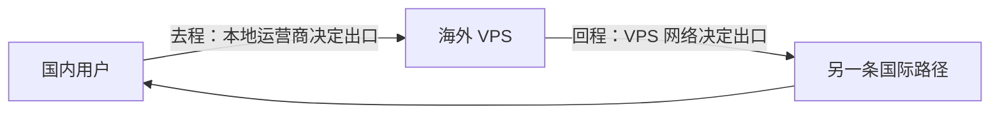

# 买 VPS 前，先看懂 ASN：商家说的“线路优化”到底优化了什么

过去一个月，为了选一台网络合适的 VPS，我陆续花了几百元，也查了大量资料。

真正让人困惑的不是 CPU、内存和硬盘，而是商家对网络的描述：

- 国际线路；
- CN2、CN2 GIA、CN2 GT；
- 三网优化、三网 CMI；
- 联通 9929、移动 CMIN2；
- BGP 多线、精品网、直连线路。

这些名称看起来都与“更快”有关，但它们究竟优化了什么？一台普通国际线路的 VPS，实际 `ping` 值有时也很好，为什么“优化线路”还要贵几倍？

问题的根源不在于商家的名词太多，而在于没有先弄清互联网最基本的组成方式。

互联网并不是一张由某个机构统一管理的巨型网络。它是由许多独立网络连接起来的“网络之网”。这些独立网络就是 **AS**。理解 AS 之后，CN2、CMI、Peering 和国际线路等名词才能落到同一张地图上。

本文从四个问题展开：

1. 什么是 AS？
2. AS 之间怎样通信？
3. 常见 ASN 和 VPS 商家术语分别指什么？
4. 普通线路差在哪里，应该怎样比较和选择？

---

## 一、什么是 AS

### 1.1 从一次普通的网页访问说起

家里的电脑访问一台海外 VPS 时，数据并不是直接从电脑“飞到”服务器。它需要依次经过多个网络：



这些网络可能分别属于不同运营商，也可能采用完全不同的内部结构和选路策略。

例如，中国电信需要决定用户流量从哪个国际出口离开；海外运营商需要决定流量经过哪条海缆、在哪座城市交给下一个网络；VPS 所在网络则要决定从哪个上游接收流量。

要让这些独立网络互相识别，首先需要给每个网络划定一个路由管理边界。这就是 AS。

### 1.2 AS 是一个对外统一选路的网络

AS 是 Autonomous System 的缩写，中文译为“自治系统”。根据 [RFC 4271](https://www.rfc-editor.org/rfc/rfc4271.html) 的定义，它是一组处于同一技术管理体系下、对外呈现一致路由策略的网络和路由器。

这个定义包含两个重点：

1. **内部由自己管理**：使用什么路由器、怎样连接各城市、内部怎样选路，其他 AS 不需要知道；
2. **对外呈现统一策略**：它需要告诉其他网络“哪些 IP 地址可以通过我到达”，以及“我愿意把哪些流量转交给谁”。

因此，AS 不是一台路由器，也不一定是一家公司。它是一个**路由策略域**。

大型运营商通常拥有多个 AS。一家公司可以根据公众互联网、政企业务、国际网络或历史网络划分不同的路由策略域。反过来，一家小型 VPS 商家也可能没有自己的 AS，而是直接使用上游机房提供的 IP 和网络。

### 1.3 ASN 是 AS 的编号

每个需要在公网 BGP 中独立运行的 AS，都需要一个唯一编号，称为 ASN（Autonomous System Number）。常见写法是在编号前加上 `AS`：

- `AS4134`；
- `AS4809`；
- `AS58453`。

ASN 由全球区域互联网注册管理机构体系分配。编号只是标识，没有等级关系。`AS4809` 不比 `AS4134` 高一级，也不能只根据数字大小判断网络规模和质量。

### 1.4 IP 与 AS 到底是什么关系

入门时经常听到“每个 IP 都属于一个 AS”。这句话可以帮助建立直觉，但不够严谨。

互联网路由的基本单位不是单个 IP，而是 **IP 前缀**。例如：

```text
146.88.129.0/24
```

这个前缀包含从 `146.88.129.0` 到 `146.88.129.255` 的一组 IPv4 地址。某个 AS 通过 BGP 向外宣布：“这一段地址可以从我这里到达。”位于 BGP 路径末端的 AS，称为这段前缀的**起源 AS（Origin AS）**。

所以，更准确的关系是：

```text
目标 IP
  -> 匹配到一个公网 IP 前缀
  -> 该前缀由一个或多个起源 AS 发布
  -> 其他 AS 学习如何到达这个前缀
```

IP 地址的注册持有者、BGP 起源 AS 和实际销售 VPS 的公司，也可能不是同一主体。商家租用上游网络的地址时，这种情况十分常见。

### 1.5 互联网本来就是“很多小网络互联”

过去有人把中国互联网概括为一个“巨大的局域网”。从 AS 的角度看，这种描述并不准确。

无论中国境内还是全球互联网，基础结构都是不同网络之间的互联。家庭宽带、城域网、骨干网、内容网络、云服务商和国际运营商分别管理自己的网络，再通过路由协议交换可达性。

网络访问控制、跨境管理和运营许可是另外一个层面的问题，不会改变互联网由多个 AS 互联而成这一基本事实。

中国电信、中国联通、中国移动和中国广电是普通用户最常接触的基础电信运营商，但这不代表中国只有四个 AS。云厂商、内容平台、高校和科研机构也可以拥有自己的 ASN 和骨干网络；它们仍需要与其他运营商互联，才能让用户访问到自己的服务。

## 二、AS 之间是怎样通信的

理解了 AS，还需要回答一个更实际的问题：一台中国电脑怎样知道，前往海外 VPS 的数据应该交给哪个网络？

答案由路由表和 BGP 共同给出。

### 2.1 路由表：为数据寻找下一站

路由器收到一个数据包后，会查看目标 IP，再查询自己的路由表。路由表可以简化为一组规则：

```text
如果目标属于前缀 A，把数据交给下一跳 X；
如果目标属于前缀 B，把数据交给下一跳 Y；
如果没有更具体的匹配，使用默认路由 Z。
```

路由器使用“最长前缀匹配”选择最具体的规则。它不需要知道数据包的完整旅程，只需要知道下一站应该交给谁。

这种转发方式与快递不同：数据包出发时并没有写好完整的中转站列表。每一段网络都根据自己的路由表继续作出决定。

### 2.2 BGP：AS 之间交换“哪里可以到达”

BGP（Border Gateway Protocol，边界网关协议）是 AS 之间交换路由信息的协议。

当一个 AS 发布某段 IP 前缀时，邻居 AS 会学习这条路由，再根据策略决定是否继续告诉其他邻居。路由信息由此逐步传播到互联网的其他部分。

一条简化的 BGP 路由可能是：

```text
目标前缀: 146.88.129.0/24
AS_PATH:  58453 3491 963
```

这表示从当前观察位置到目标前缀，需要沿 BGP 路径经过 `AS58453`、`AS3491`，最终到达起源 `AS963`。

`AS_PATH` 还有一个重要作用：防止路由循环。如果一个 AS 在收到的路径中发现了自己的 ASN，就知道这条路由已经绕回自己，不应继续采用。

### 2.3 BGP 选择的不是“最快路径”

BGP 解决的是“数据可以从哪里到达”，而不是“哪条路径延迟最低”。

一个网络同时收到多条路径时，通常会综合考虑：

- 哪条路径来自自己的客户；
- 哪条路径来自免费或低成本的互联；
- 网络管理员设置的本地优先级；
- `AS_PATH` 长度；
- 故障切换与流量调度策略。

商业成本往往比物理距离更早进入选路决策。因此，东京 VPS 的数据可能先去美国再回到亚洲；一条只经过两个 AS 的路径，也可能比经过四个 AS 的路径更拥塞。

这正是 VPS “绕路”现象的来源：路径在 BGP 策略上合理，但在地理距离和用户体验上未必理想。

### 2.4 Upstream、Downstream 与 IP Transit

AS 之间虽然在编号上没有高低级，但在商业关系上并不平级。

假设一家 VPS 网络没有能力与全球所有网络分别连接。它可以向大型运营商购买“访问整个互联网”的服务，这项服务称为 **IP Transit**。

在这段关系中：

- 出售互联网可达性的网络是 **Upstream（上游）**；
- 购买服务的 VPS 网络是上游的 **Downstream 或 Customer（下游/客户）**；
- 上游不仅告诉客户自己的路由，还帮助客户到达其他网络。

一个 VPS 网络可以同时购买多个上游。这样既能增加可达性，也能在某条链路故障时切换。但“多上游”不等于一定更快，因为最终仍取决于路由策略、端口容量和拥塞情况。

### 2.5 Peering：两个网络直接交换彼此流量

如果两个网络之间流量很大，每次都绕过第三方 Transit，不仅成本高，路径也可能更长。它们可以建立 Peering（对等互联），直接交换双方及各自客户的流量。

Peering 与 Transit 的主要区别是：

| 互联方式   | 能到达的范围                   | 常见商业关系     |
| ---------- | ------------------------------ | ---------------- |
| IP Transit | 上游帮助客户到达整个互联网     | 客户向上游付费   |
| Peering    | 通常只交换双方及双方客户的流量 | 可免费，也可付费 |

Peering 不是“两个 ASN 之间接了一根线”这么简单。双方还需要约定接入地点、端口容量、可发布的路由和流量比例。

### 2.6 IX：让许多 AS 集中互联的交换中心

IX 或 IXP 是 Internet Exchange Point 的缩写，即互联网交换中心。

它通常提供一套共享的二层交换网络，让多家 AS 在同一个地点建立 Peering。这样，每家网络不必分别铺设大量点对点线路，就能更方便地与其他成员互联。

需要区分两个概念：

- **IX 是互联设施和场所**；
- **Peering 是网络之间的路由关系**。

两家网络同时接入一个 IX，不代表它们一定会互相交换流量。是否建立 Peering，仍由双方策略决定。

### 2.7 POP：运营商在一座城市的网络落点

POP 是 Point of Presence 的缩写，可以理解为某个网络在一座城市或机房中的服务节点。

香港、东京、新加坡、洛杉矶等城市拥有大量运营商 POP、数据中心、海缆资源和 IX，所以经常出现在 VPS 宣传中。网络在这些地点拥有 POP，意味着它有更多建立互联的可能，但不表示所有线路都会自动变好。

## 三、常见 ASN 与 VPS 商家术语

建立了 AS、BGP 和网络互联的基础后，再看 VPS 商家的线路名称就容易得多。

### 3.1 中国用户经常遇到的 ASN

下表只列出 VPS 路由中常见的骨干和国际网络，不代表运营商拥有的全部 ASN。

| 体系         |         ASN | 公开名称                      | 常见称呼           | 主要角色         |
| ------------ | ----------: | ----------------------------- | ------------------ | ---------------- |
| 中国电信     |  `AS4134` | `CHINANET-BACKBONE`         | 电信 163、ChinaNet | 公众互联网骨干   |
| 中国电信     |  `AS4809` | `CHINATELECOM-CORE-WAN-CN2` | CN2                | 下一代承载网络   |
| 中国电信国际 | `AS23764` | `CTGNet`                    | CTGNet             | 全球网络之一     |
| 中国联通     |  `AS4837` | `CHINA169-Backbone`         | 联通 169、China169 | 公众互联网骨干   |
| 中国联通     |  `AS9929` | `CUII`                      | 联通 9929、A 网    | Premium 承载网络 |
| 中国联通国际 | `AS10099` | `UNICOM-Global`             | CUG、联通国际      | 国际网络         |
| 中国移动     |  `AS9808` | `CHINAMOBILE-CN`            | CMNET、移动 9808   | 公众互联网骨干   |
| 中国移动国际 | `AS58453` | `CMI-INT-HK`                | CMI                | 国际 IP 网络     |
| 中国移动国际 | `AS58807` | `CMI-INT-AS`                | CMIN2              | 另一张国际网络   |
| 教育网       |  `AS4538` | `ERX-CERNET-BKB`            | CERNET             | 教育科研骨干网   |
| 科技网       |  `AS7497` | `CSTNET-AS-AP`              | CSTNET             | 科技网骨干       |

这张表首先说明：电信、联通和移动都不只有一张网络。

以中国电信为例

早期（90年代末-2000年代初）：中国电信主要使用 AS4134 (ChinaNet 163) 作为全国统一的骨干网AS号。各省节点（包括上海）通常都在AS4134内部运行，或通过特定的内部协议互联
2004年左右，中国电信为了提供高质量的国际出口和政企专线服务，建设了完全独立于163网（AS4134）之外的CN2（AS4809）网络。这标志着中国电信正式进入“双骨干”时代。AS4809与AS4134是并行关系，而非继承关系。
2017年，CTGNet（AS23764） 开始作为独立于 ChinaNet (AS4134) 和 CN2 (AS4809) 之外的第三张骨干网，专门面向国际业务和跨境政企客户提供服务。

在骨干网之外，电信还有很多专门目的的网络，比如 中国电信上海骨干网`AS4812`, 广东骨干网`AS58466`

这些 AS 都是独立的一张网络，根据电信自己的路由策略，上海、广东骨干网，会跳入 全国骨干网（163、CN2），然后接入全球。

这里要注意，中国电信全国骨干网(163,CN2) 是直接接入全球的，国内骨干网这个说法有点让让以为它只在国内部署，只是不是这样的，它会在全球是到处部署的都有路由器节点，比如著名的美西洛杉矶、东京、法兰克福等等，它会跟其他 tier1 运营商机型对等交互流量，或者采购其他运营商的 ip transmit，来增强它的全球触达能力。163 、CN2、CTGNet都是电信的骨干网络，只不过 163、CN2 绝大部分 ip 都在中国，主要服务于中国大陆用户，CTGNet服务于国际用户，

CN2(AS4809) 的 IP 地址覆盖范围
| 地区 | ip 比例 |
| ---- | ---- |
|China|95.9%|
|Hong Kong|2.3%|
|United States|0.4%|
|Australia|0.2%|
|Germany|0.2%|
|United Kingdom|0.2%|
|Singapore| 0.2%|
|France| 0.1%|
|Japan | 0.1%|

CTGNet（AS23764）的 IP 地址覆盖
| 地区 | ip 比例 |
| ---- | ---- |
| Hong Kong | 36.2% |
| China |12.4%  |
| Singapore |11.5%  |
| United Kingdom |7.4%  |
| Germany | 6.8%  |
| South Africa | 4.5% |
| Japan | 4.2%  |
| Kenya | 3.9%  |
| United Arab Emirates | 3.1% |
| Brazil | 2.6% |

通过 ip 覆盖范围可以看出，都是骨干网，都是全球部署，但是重点不一样而已。

163 作为基础网络，国际上基本不会有别人直接采购它，163 基本只要保证国内能触达全球就好。
但是CN2网络，因为国际上的一些 vps，为了增加让跟中国大陆网络更加稳定，所以会花钱采购，所以 CN2 的线路就会单独收费。

至于CTGNet，就类似于 NTT、IIJ 一样只是一个国际网络运营商，中国电信想扩展国际生意，比如提供新加坡到日本的国际路由能力，于是提供了这样的一张骨干网。
163、CN2 的国际触达不靠CTGNet。

但是如果你在国际上买了 CTGNet 的接入，你会发现在中国电信用户访问的延迟以及稳定一般都是不错，这是因为都是电信内部的网络，从163 跳到 CTGNet，有内部优先级优化。
但是 CTGNet 接入的 vps 很少见，至少我没有见过


同理，中国联通的 `AS4837`、`AS9929` 和 `AS10099`， 完全一一对对应电信的 `AS4134` `AS4809` `AS23764`
联通国际的AS10099 接入的 vps，我还是见过一些

中国移动特别点，国内承载的骨干网只有一个CMNET`AS9808`， 国际上却有两个分别是CMI`AS58453` 和 CMIN2`AS58807`，然后，CMNET 不直接触达全球，它会把流量交付到 CMI 或者 CMIN2 上。
CMNET 怎么触达全球是移动自己内部的策略，也许哪一天，CMNET就直接跟全球其他 AS 交互了。
其中 CMI是普通骨干网，CMIN2 是精品骨干网。

所以 vps说的普通三往优化，定是流量最终到流向电信 163（AS4134）｜ 联通 169（AS4387）｜ 移动 CMI (AS58453->AS9808), 然后跳入最终终端用户

三网精品优化线路那就是流量会经过 电信 CN2（AS4809）｜ 联通（AS9929）｜ 移动 CMINN2(AS23764 -> AS9808), 然后跳入最后终端用户

### 3.2 “普通国际线路”普通在哪里

商家所说的普通国际线路，通常没有统一技术定义。它往往表示 VPS 使用常见国际 Transit，上游根据成本和自己的 BGP 策略把流量送往中国。

这种线路不一定慢。在网络空闲、路由较短时，它同样可能得到不错的 `ping`。它真正的不确定性通常体现在：

- 没有针对中国电信、联通、移动分别安排入口；
- 去程看起来正常，回程却可能绕路；
- 国际互联端口在晚高峰更容易排队；
- 上游调整路由后，线路可能突然改变；
- 三家运营商的体验差异很大。

所以，“普通”不是指每个时刻都慢，而是指**面向特定中国网络的路由与容量保障通常更少**。

### 3.3 产品名字跟术语

**CN2 GIA** 是 Global Internet Access 的缩写，这是产品名称，表明在中国电信内部的网络，都会全程使用CN2 网络。

**CN2 GT** 也是一种产品名称，中国电信提供的一种产品， 表明国内段使用163 骨干，然后国际段使用 CN2 骨干。

**联通 9929** 就是指

`AS9929` 的公开名称是 CUII。中国联通国际的产品资料将它描述为 Premium bearer network，即精品承载网络。

VPS 商家宣传“联通 9929”，通常是指中国方向的部分路径接入这张网络。它对联通用户往往更有针对性，但不能据此假设电信和移动用户一定获得同样的路径质量。

### 3.5 CMI 与 CMIN2

CMI 是中国移动国际运营的网络，对应常见的 `AS58453`。CMIN2 则在中国移动国际公开 SLA 中对应 `AS58807`。

海外 VPS 接入 CMI 后，进入中国移动网络通常比随机选择其他国际 Transit 更直接。这就是商家强调“移动 CMI”的原因。

但“三网 CMI 优化”需要更谨慎地理解。它通常表示商家尝试让电信、联通和移动用户都利用 CMI 或相关互联进入 VPS，并不是统一的行业标准。

要证明“三网 CMI”，至少需要分别观察电信、联通、移动的实际路径。只测移动宽带，不能替电信和联通得出结论。

### 3.6 BGP 多线

“BGP 多线”通常表示 VPS 所在网络连接了多个上游，并通过 BGP 发布路由。

它能带来两个潜在收益：

- 一个上游故障时，可以切换到另一个上游；
- 可以针对不同目标网络选择不同出口。

但多线只是能力，不是效果保证。若多个上游都拥塞，或者商家的路由策略只追求低成本，多线仍然可能很慢。

### 3.7 用一个公开测试 IP 看懂“ASN 不等于完整线路”

以 XLC Looking Glass 在 2026-07-30 公开的东京测试 IP `146.88.129.226` 为例，RIPEstat 当日查询结果为：

```json
{
  "prefix": "146.88.129.0/24",
  "asns": ["963"]
}
```

这表示该测试 IP 所属的 `146.88.129.0/24` 前缀由 `AS963` 起源。

继续查看不同 BGP 采集点，可以同时看到多条路径：

```text
AS55720 -> AS6939  -> AS963
AS7018  -> AS3491  -> AS963
AS8529  -> AS58453 -> AS3491 -> AS963
```

同一个目标前缀，在不同网络眼中可以有不同的到达方式。其中一条路径经过 CMI `AS58453`，另外两条没有。

这正好说明：

- 起源 ASN 只说明路径最终到达哪个 AS；
- 上游和中转 AS 才构成完整线路；
- 从其他地区观察到的 BGP 路径，不能代替自己的实际访问路径。

## 四、普通线路差在哪里，以及怎样选择

### 4.1 网络质量不是一个数字

比较 VPS 线路时，至少要拆成四个指标：

| 指标 | 它反映的问题                         |
| ---- | ------------------------------------ |
| 延迟 | 一次往返需要多长时间                 |
| 抖动 | 延迟是否忽高忽低                     |
| 丢包 | 数据是否需要重传，实时业务是否会卡顿 |
| 吞吐 | 持续传输实际能达到多少带宽           |

`ping` 主要观察延迟和丢包，不能直接代表吞吐。端口标注 `1 Gbps`，也只表示接口上限，不表示中国用户随时能以 `1 Gbps` 下载。

一条线路可能平均延迟只有 `40 ms`，但晚高峰频繁跳到 `200 ms`；也可能 `ping` 稳定，却因为丢包导致单连接下载很慢。

### 4.2 三网可达性

中国电信、联通和移动拥有不同的骨干、国际网络与互联策略。一台 VPS 对移动用户表现很好，不代表电信用户也一样。

面向中国用户提供服务时，至少要分别回答：

- 电信怎样到达 VPS？
- 联通怎样到达 VPS？
- 移动怎样到达 VPS？

如果实际用户只来自某一家运营商，就没有必要为“三网精品”支付全部溢价。线路选择应从用户分布出发，而不是从宣传等级出发。

### 4.3 去程和回程必须分开看

从家里运行 `traceroute` 或 `mtr`，看到的是本地到 VPS 的去程。VPS 返回本地的回程由另一侧网络选择，可能完全不同。



一条常见的“半程优化”线路，可能只有回程经过精品网，去程仍走普通骨干；也可能只优化移动，电信和联通继续走普通 Transit。

商家只说“接入 CN2”而不说明运营商和方向时，信息是不完整的。

### 4.4 为什么晚高峰特别重要

光纤传播距离不会在晚上改变，但链路上的排队会改变。

当跨境链路或互联端口接近容量上限时，新到达的数据包必须等待，队列装满后还会丢包。此时会出现：

- RTT 明显升高；
- 延迟波动增大；
- TCP 触发拥塞控制，下载速度下降；
- SSH、游戏和实时音视频出现卡顿。

白天 `ping` 一次只能证明白天的瞬时状态。面向国内用户的线路，至少应该在工作日 `20:00` 至 `23:00` 再测一次。

### 4.5 香港、日本、新加坡和美国西岸怎样选

机房位置首先决定物理距离，但最终体验仍由线路决定。

| 地区             | 对中国用户的直观特点           | 需要警惕的问题                     |
| ---------------- | ------------------------------ | ---------------------------------- |
| 香港             | 距离近，理论延迟最低           | 优质跨境容量昂贵，低价线路可能拥塞 |
| 日本             | 华东、华北距离较近，机房选择多 | 不同上游差异大，也可能绕路         |
| 新加坡           | 适合东南亚业务，国际互联丰富   | 到中国的物理距离高于香港、日本     |
| 洛杉矶等美国西岸 | 套餐多、带宽和流量通常更便宜   | 跨太平洋传播下限更高               |

“香港一定最好”或“洛杉矶一定最慢”都不成立。香港普通线路可能在晚高峰严重拥塞，优质美国西岸线路则可能保持稳定。位置决定起点，互联和容量决定最终表现。

### 4.6 初学者只需要完成这组最小测试

购买前向商家索取测试 IP 和 Looking Glass。没有测试入口时，线路描述无法在购买前验证。

在自己的网络执行：

```bash
# 连续探测路径，-z 会在支持的版本中显示 ASN，-c 100 表示发送 100 次。
mtr -4 -r -w -z -c 100 商家测试IP
```

初次查看结果时只抓住三点：

1. **看路径经过哪些 ASN**：核对是否出现商家声称的 `AS4809`、`AS9929`、`AS58453` 或 `AS58807`；
2. **看问题是否延续到终点**：中间某一跳显示高丢包，但后续和终点正常，通常只是路由器限制 ICMP 响应；
3. **换时段重复测试**：白天和晚高峰差异，比单次最低延迟更有价值。

购买后，再从 VPS 向自己的公网 IP 运行一次 `mtr`，观察回程。家庭宽带若使用 CGNAT 或屏蔽 ICMP，终点可能不响应，此时可以借助商家的 Looking Glass 或不同运营商的公开测试节点辅助判断。

### 4.7 最终选择顺序

对初次购买者，一套更可靠的决策顺序是：

1. **先确定用户在哪里、使用哪家运营商**；
2. **再根据物理距离筛选香港、日本、新加坡或美国西岸等地区**；
3. **取得测试 IP，检查实际 ASN 路径**；
4. **分别观察去程和回程，不把单向优化当作双向优化**；
5. **在晚高峰重复测试延迟、抖动和终点丢包**；
6. **先买月付或短周期套餐，再考虑长期付款**。

线路优化的价值也由业务决定：

| 使用场景           | 更应关注什么                         |
| ------------------ | ------------------------------------ |
| SSH、远程开发      | 低抖动、低丢包、晚高峰稳定           |
| 面向国内用户的网站 | 用户所属运营商的双向路径             |
| 大文件下载与备份   | 持续吞吐、月流量和限速规则           |
| 游戏、语音和视频   | 长尾延迟、抖动和丢包                 |
| 主要访问海外服务   | 海外互联质量，不必盲目购买回国精品线 |

## 结语

看懂 VPS 线路，不需要先成为网络工程师。只需要建立一条从概念到事实的推理链：

```text
互联网由许多 AS 组成
  -> ASN 标识不同的路由策略域
  -> BGP 决定 AS 之间如何传播路由
  -> Transit、Peering 和 IX 决定网络怎样互联
  -> CN2、9929、CMI 等名称对应具体网络
  -> 去程、回程、拥塞和容量共同决定实际体验
```

商家的线路名称不是完全没有价值，但它只能作为调查入口，不能作为最终结论。

真正可靠的选购方法，是把“CN2 GIA”“三网 CMI”“国际优化”等宣传词还原为三个可以验证的问题：经过哪个 AS、在哪个方向经过、晚高峰表现如何。

理解这三个问题之后，VPS 网络不再是一串需要死记的黑话，而是一张可以逐段读懂的互联网连接图。

## 参考资料

1. [RFC 4271：A Border Gateway Protocol 4](https://www.rfc-editor.org/rfc/rfc4271.html)
2. [APNIC：How do we count ASNs?](https://blog.apnic.net/2021/03/19/how-do-we-count-asns/)
3. [APNIC：How to properly interpret a traceroute or MTR](https://blog.apnic.net/2022/03/28/how-to-properly-interpret-a-traceroute-or-mtr/)
4. [中国电信国际：IP Network Management System / Looking Glass](https://ipms.chinatelecomglobal.com/)
5. [中国联通国际：IP Transit and Peering](https://eu.chinaunicomglobal.com/products-ipt-and-peering)
6. [中国移动国际：Settlement-Free Peering Policy — AS58453](https://www.cmi.chinamobile.com/pdf/zaqxwwtgblephes/Peering_Policy_For_External.pdf)
7. [中国移动国际：CMI / CMIN2 SLA Terms](https://mainwebapi.cmi.chinamobile.com/uploads/template/20251216272c9a10af6d23e3b7c459e04e91bf4b.pdf)
8. [RIPEstat Data API](https://stat.ripe.net/docs/data_api)

---

*作者：[AI-Authored Tech Chronicles]*
*系列：《VPS 网络选购入门》第一篇*
*分析基于：IETF RFC 4271、APNIC、中国电信国际、中国联通国际、中国移动国际与 RIPEstat，资料读取于 2026-07-30*
